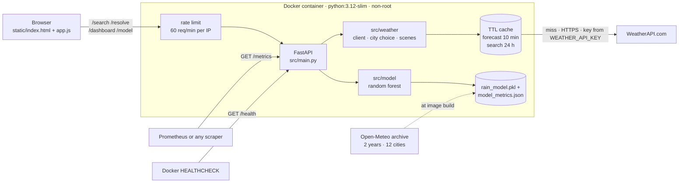
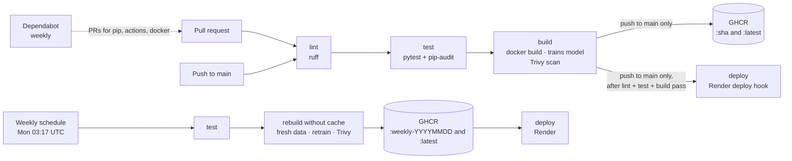
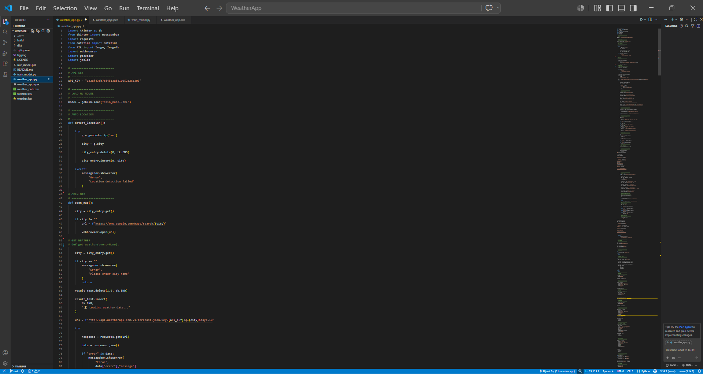
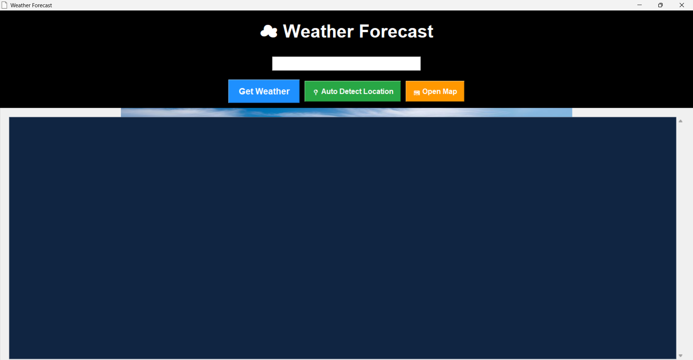
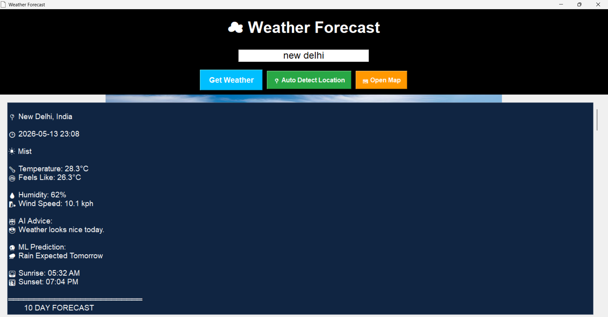
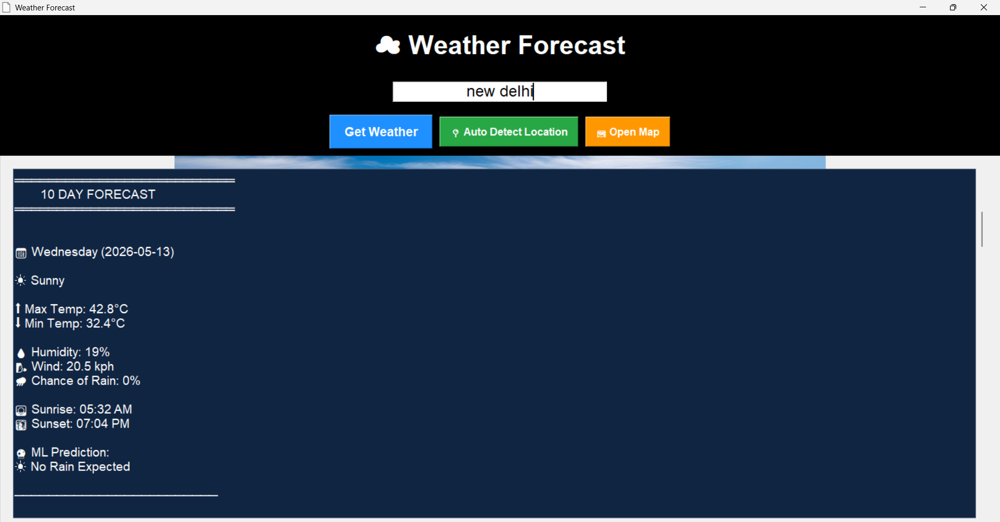

# AI Weather Forecast App

[](https://github.com/Ujjwalraj1808/AI-Weather-Forecast-App/actions/workflows/ci.yml)

**Live demo:** https://ai-weather-forecast-app.onrender.com


A containerised FastAPI web app showing live weather from [WeatherAPI.com](https://www.weatherapi.com/):
current conditions, the next 24 hours, a multi-day forecast and an experimental ML rain estimate.
It started as a Tkinter desktop app and was rebuilt as a tested, containerised and continuously deployed web service.
The rain model is trained from two years of real hourly observations (Open-Meteo) every time the image is built, and its held-out scores are published at `/model`.

## Architecture



## Features

- **City search with suggestions** showing city, region and country. Typing "Delhi" gives Delhi, India, not Delhi, Canada (see [How a city is chosen](#how-a-city-is-chosen)). When a name is still ambiguous, the app asks you to choose.
- **Use my location** and **Open in Google Maps** (exact coordinates).
- **Current weather, a 24-hour strip and a multi-day forecast** with temperature-range bars.
- **Backgrounds that follow the real sky:** clear day or night, golden hour, cloudy, rain, storm, snow and fog.
- **ML rain estimate** for tomorrow with its probability, trained on real historical observations and shown apart from WeatherAPI's forecast, with the model's held-out scores on the page.
- **Clear errors** for unknown places, invalid keys, quota limits, timeouts and network failures.
- **Responsive and accessible** from 320px phones to desktops, with keyboard support and reduced motion.
- **Observability:** `/health` for container health checks, `/metrics` for Prometheus, `/model` for model provenance and scores.
- **Cost control:** one WeatherAPI call per search (`/dashboard`), a 10-minute forecast cache, and a per-IP rate limit.

## Tech stack

| Area | Tools |
|---|---|
| Backend | Python 3.12, FastAPI, Uvicorn, Requests |
| ML | scikit-learn (random forest), pandas, joblib; training data from Open-Meteo |
| Front end | Plain HTML, CSS and JavaScript (no frameworks) |
| Quality | pytest, ruff |
| Containers | Docker (multi-stage, non-root, HEALTHCHECK), Docker Compose |
| CI/CD | GitHub Actions (SHA-pinned), pip-audit, Trivy, Dependabot, GitHub Container Registry (GHCR), Render |
| Monitoring | prometheus-client |

## Run locally

### With Docker (recommended)

```powershell
Copy-Item .env.example .env      # then put your WeatherAPI key in .env
docker compose up --build -d
docker compose ps                 # wait for STATUS "healthy"
```

Open http://localhost:8000. During the build the image downloads two years of hourly history from Open-Meteo and trains the model, so no data or `.pkl` is committed. The build needs internet and fails if the model does not pass its quality gate.

### Without Docker

```powershell
py -3.12 -m venv .venv
.venv\Scripts\Activate.ps1
pip install -r requirements-dev.txt
python -m src.model.data          # downloads data/weather_history.csv from Open-Meteo
python -m src.model.train         # creates rain_model.pkl and model_metrics.json
$env:WEATHER_API_KEY = "your_key"
uvicorn src.main:app --reload
```

### Tests

```powershell
pytest                            # all WeatherAPI calls are mocked; no key or network needed
ruff check .
docker compose config --quiet     # validates compose without printing your key
```

## CI/CD



- **`.github/workflows/ci.yml`**
  - Runs on every pull request and push to `main`, in the order lint → test → build.
  - `test` also runs `pip-audit` against `requirements.txt`, so a dependency with a known vulnerability fails the build.
  - `build` builds the image (which downloads data and trains the model), then scans it with Trivy; any fixable CRITICAL or HIGH finding fails the build.
  - On a push to `main`, it pushes the image to `ghcr.io/ujjwalraj1808/ai-weather-forecast-app` (tagged with the commit SHA and `latest`) and calls the Render deploy hook.
- **`.github/workflows/weekly-retrain.yml`**
  - Runs every Monday, and can also be started by hand from the Actions tab.
  - Rebuilds the image without cache, so the model is retrained on the latest two years of Open-Meteo data, prints the new scores, scans, pushes to GHCR and triggers a Render deploy.
- **Supply chain:** every action is pinned to a full commit SHA, and Dependabot opens weekly PRs for Python packages, actions and the base image.

### One-time setup

1. **Render:** create a Web Service from this repo with the *Docker* runtime.
   - Set `WEATHER_API_KEY` (and optionally `PREFERRED_COUNTRY`) under Environment.
   - Turn auto-deploy off, so deploys come only from CI after the checks pass.
   - Render sets `PORT`; the container listens on it.
2. **Render → Settings → Deploy Hook:** copy the URL.
3. **GitHub → Settings → Secrets and variables → Actions:** add a secret named `RENDER_DEPLOY_HOOK` with that URL.
4. Replace the live demo link at the top of this README with your Render URL.

## Configuration

| Variable | Required | Default | Purpose |
|---|---|---|---|
| `WEATHER_API_KEY` | yes | none | WeatherAPI key. Read only from the environment; never logged or returned. |
| `PREFERRED_COUNTRY` | no | `India` | Tie-breaker when a bare city name matches places in several countries |
| `PORT` | no | `8000` | Port the container listens on |
| `MODEL_PATH` | no | `rain_model.pkl` | Where the model is saved and loaded |
| `METRICS_PATH` | no | `model_metrics.json` | Model provenance and scores, served at `/model` |
| `RATE_LIMIT_PER_MINUTE` | no | `60` | Requests per minute per client IP on the weather endpoints |
| `MIN_ROC_AUC` | no | `0.65` | Training fails (and nothing deploys) if the held-out ROC AUC is below this |
| `TRAINING_DATA_PATH` | no | `data/weather_history.csv` | Where `src.model.data` writes the downloaded history |

Never commit `.env`; it is in `.gitignore` and `.dockerignore`.

## API

| Endpoint | Description |
|---|---|
| `GET /health` | Health check used by Docker's `HEALTHCHECK` |
| `GET /metrics` | Prometheus metrics: `http_requests_total` and `http_request_duration_seconds`, labelled by method and route |
| `GET /model` | How the model was trained (data range, cities, sample counts) and its held-out scores |
| `GET /dashboard?city=&days=` | Current conditions, hourly, daily and the rain estimate from **one** WeatherAPI call (what the page uses) |
| `GET /search?q=` | Place suggestions (id, name, region, country, lat, lon) |
| `GET /resolve?q=` | Free text to one exact place (`409` with candidates if ambiguous) |
| `GET /weather?city=` | Current conditions plus the background scene |
| `GET /forecast?city=&days=` | Daily forecast (1–14 days) and the next 24 hours |
| `GET /predict-rain?city=` | ML rain estimate for tomorrow: `rain_expected` and `probability` |

`city` accepts free text ("Delhi, India"), a place id from `/search` (`id:123`) or coordinates (`28.61,77.21`).

Error status codes:

| Status | Meaning |
|---|---|
| 404 | Place not found |
| 409 | Several places match; the response lists them |
| 429 | This app's per-IP rate limit (`Retry-After` header), or WeatherAPI's quota |
| 502 | WeatherAPI error |
| 503 | API key missing or rejected |
| 504 | WeatherAPI timed out |

## How a city is chosen

WeatherAPI's search does not always list every place with a name. On 2026-10-15, searching "Delhi" returned only Delhi, Ontario, Canada, while "Delhi, India" returned Delhi, India. So the app:

1. Searches the name. If nothing in `PREFERRED_COUNTRY` comes back, it also searches "name, PREFERRED_COUNTRY" and merges the results.
2. With a qualifier ("Delhi, India", "London, UK", "Springfield, Missouri"), searches the full text and the name, and keeps matches for that country or region.
3. Prefers exact name matches, and lets `PREFERRED_COUNTRY` break a tie.
4. Asks you to choose if it is still ambiguous ("London", "Springfield").

All requests for one search then use that place's id, so the weather, forecast and ML estimate describe the same place.

## Dynamic backgrounds

`src/weather/scenes.py` maps WeatherAPI's condition code and day/night flag to a scene. Clear skies within 45 minutes of local sunrise or sunset become "golden".

- **Gradients:** each scene is a CSS gradient with CSS-drawn rain, snow, fog or stars. Animation stops when the system asks for reduced motion.
- **Photos (optional):** add licensed photos as `static/img/<scene>.webp` (see `static/img/README.md`). The gradient stays if a photo is missing or fails to load.
- **Fonts:** Bricolage Grotesque and Figtree are self-hosted in `static/fonts/` under the SIL Open Font License.

## The ML estimate

**Question the model answers:** given the weather right now, will at least 1 mm of rain fall tomorrow (the next local calendar day)?

**Data:** `src/model/data.py` downloads two years of hourly observations for 12 cities with different climates (Delhi, Mumbai, Kolkata, Chennai, Bengaluru, Patna, London, Paris, Stockholm, New York, Singapore, Sydney) from the [Open-Meteo historical archive](https://open-meteo.com/en/docs/historical-weather-api) (ERA5 reanalysis, CC BY 4.0). Every third hour becomes one sample; its label is whether the following day's precipitation reached 1 mm.

**Features:** humidity, wind speed, temperature, sea-level pressure, cloud cover and the month (as sine/cosine). These are exactly the values WeatherAPI reports for current conditions, so the live app feeds the model the same kind of input it was trained on.

**Model:** a scikit-learn random forest (`src/model/train.py`), class-balanced, with a fixed seed.

**Honest evaluation:** the newest 20% of dates are held out, so the model is scored on weather it has never seen and on a later period than it trained on. The scores are written to `model_metrics.json` and served at `/model`; they also include the "always say no rain" baseline so the lift is visible. If the held-out ROC AUC is below `MIN_ROC_AUC`, training raises an error, the Docker build fails and nothing deploys.

**Limits:** it uses one hour's conditions in one place, with no radar, no pressure trend and no forecast model behind it, so it will never match WeatherAPI's forecast. The page labels it as a separate estimate and points to WeatherAPI's chance of rain for planning.

## Project layout

```
src/main.py              FastAPI app and endpoints
src/metrics.py           Prometheus request metrics
src/cache.py             In-memory TTL cache
src/ratelimit.py         Per-IP rate limit middleware
src/weather/client.py    WeatherAPI client, city choice, parsing, error mapping, caching
src/weather/scenes.py    Condition -> background scene
src/model/data.py        Downloads and labels Open-Meteo history
src/model/train.py       Trains, evaluates on held-out dates, quality gate
src/model/predict.py     Builds features from live conditions and predicts
static/                  index.html, app.js, style.css, fonts/, img/
tests/                   pytest suite (no network)
docs/screenshots/        Screenshots of the original desktop app
.github/                 ci.yml, weekly-retrain.yml, dependabot.yml
Dockerfile               Multi-stage image; downloads data and trains at build time
docker-compose.yml       Local run, reads .env
```

## Original desktop version

The project began as a Tkinter desktop app (packaged as an .exe). Screenshots of that version are in [`docs/screenshots/`](docs/screenshots/):

| | |
|---|---|
|  |  |
|  |  |

## Developed by

Ujjwal Raj
