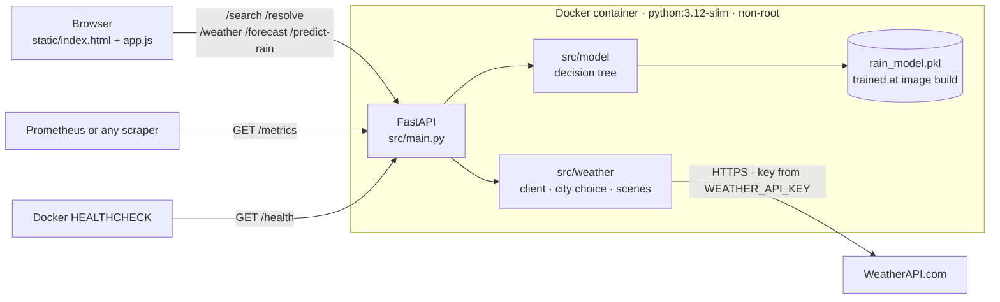
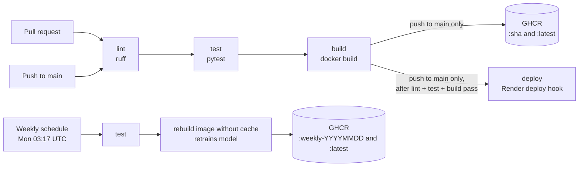

# AI Weather Forecast App

[](https://github.com/Ujjwalraj1808/AI-Weather-Forecast-App/actions/workflows/ci.yml)

**Live demo:** https://ai-weather-forecast-app.onrender.com


A containerised FastAPI web app showing live weather from [WeatherAPI.com](https://www.weatherapi.com/):
current conditions, the next 24 hours, a multi-day forecast and an experimental ML rain estimate.
It started as a Tkinter desktop app and was rebuilt as a tested, containerised and continuously deployed web service.

## Architecture



## Features

- **City search with suggestions** showing city, region and country. Typing "Delhi" gives Delhi, India, not Delhi, Canada (see [How a city is chosen](#how-a-city-is-chosen)). When a name is still ambiguous, the app asks you to choose.
- **Use my location** and **Open in Google Maps** (exact coordinates).
- **Current weather, a 24-hour strip and a multi-day forecast** with temperature-range bars.
- **Backgrounds that follow the real sky:** clear day or night, golden hour, cloudy, rain, storm, snow and fog.
- **Experimental ML estimate** of rain tomorrow, shown apart from WeatherAPI's forecast.
- **Clear errors** for unknown places, invalid keys, quota limits, timeouts and network failures.
- **Responsive and accessible** from 320px phones to desktops, with keyboard support and reduced motion.
- **Observability:** `/health` for container health checks and `/metrics` for Prometheus.

## Tech stack

| Area | Tools |
|---|---|
| Backend | Python 3.12, FastAPI, Uvicorn, Requests |
| ML | scikit-learn, pandas, joblib |
| Front end | Plain HTML, CSS and JavaScript (no frameworks) |
| Quality | pytest, ruff |
| Containers | Docker (multi-stage, non-root, HEALTHCHECK), Docker Compose |
| CI/CD | GitHub Actions, GitHub Container Registry (GHCR), Render |
| Monitoring | prometheus-client |

## Run locally

### With Docker (recommended)

```powershell
Copy-Item .env.example .env      # then put your WeatherAPI key in .env
docker compose up --build -d
docker compose ps                 # wait for STATUS "healthy"
```

Open http://localhost:8000. The model is trained inside the image during the build, so no `.pkl` is committed.

### Without Docker

```powershell
py -3.12 -m venv .venv
.venv\Scripts\Activate.ps1
pip install -r requirements-dev.txt
python -m src.model.train         # creates rain_model.pkl
$env:WEATHER_API_KEY = "your_key"
uvicorn src.main:app --reload
```

### Tests

```powershell
pytest                            # all WeatherAPI calls are mocked; no key or network needed
ruff check .
docker compose config --quiet     # validates compose without printing your key
```

## CI/CD



- **`.github/workflows/ci.yml`**
  - Runs on every pull request and push to `main`, in the order lint → test → build.
  - On a push to `main`, it also pushes the image to `ghcr.io/ujjwalraj1808/ai-weather-forecast-app`, tagged with the commit SHA and `latest`.
  - Then it calls the Render deploy hook.
- **`.github/workflows/weekly-retrain.yml`**
  - Runs every Monday, and can also be started by hand from the Actions tab.
  - Runs the tests, then rebuilds the image without cache, which retrains the model from `weather.csv`, and pushes it to GHCR.
  - Training is seeded, so the weekly model only changes when `weather.csv` changes.

### One-time setup

1. **Render:** create a Web Service from this repo with the *Docker* runtime.
   - Set `WEATHER_API_KEY` (and optionally `PREFERRED_COUNTRY`) under Environment.
   - Turn auto-deploy off, so deploys come only from CI after the checks pass.
   - Render sets `PORT`; the container listens on it.
2. **Render → Settings → Deploy Hook:** copy the URL.
3. **GitHub → Settings → Secrets and variables → Actions:** add a secret named `RENDER_DEPLOY_HOOK` with that URL.
4. Replace the live demo link at the top of this README with your Render URL.

## Configuration

| Variable | Required | Default | Purpose |
|---|---|---|---|
| `WEATHER_API_KEY` | yes | none | WeatherAPI key. Read only from the environment; never logged or returned. |
| `PREFERRED_COUNTRY` | no | `India` | Tie-breaker when a bare city name matches places in several countries |
| `PORT` | no | `8000` | Port the container listens on |
| `MODEL_PATH` | no | `rain_model.pkl` | Where the model is saved and loaded |

Never commit `.env`; it is in `.gitignore` and `.dockerignore`.

## API

| Endpoint | Description |
|---|---|
| `GET /health` | Health check used by Docker's `HEALTHCHECK` |
| `GET /metrics` | Prometheus metrics: `http_requests_total` and `http_request_duration_seconds`, labelled by method and route |
| `GET /search?q=` | Place suggestions (id, name, region, country, lat, lon) |
| `GET /resolve?q=` | Free text to one exact place (`409` with candidates if ambiguous) |
| `GET /weather?city=` | Current conditions plus the background scene |
| `GET /forecast?city=&days=` | Daily forecast (1–14 days) and the next 24 hours |
| `GET /predict-rain?city=` | Experimental ML estimate for tomorrow |

`city` accepts free text ("Delhi, India"), a place id from `/search` (`id:123`) or coordinates (`28.61,77.21`).

Error status codes:

| Status | Meaning |
|---|---|
| 404 | Place not found |
| 409 | Several places match; the response lists them |
| 429 | WeatherAPI quota or rate limit reached |
| 502 | WeatherAPI error |
| 503 | API key missing or rejected |
| 504 | WeatherAPI timed out |

## How a city is chosen

WeatherAPI's search does not always list every place with a name. On 2026-10-15, searching "Delhi" returned only Delhi, Ontario, Canada, while "Delhi, India" returned Delhi, India. So the app:

1. Searches the name. If nothing in `PREFERRED_COUNTRY` comes back, it also searches "name, PREFERRED_COUNTRY" and merges the results.
2. With a qualifier ("Delhi, India", "London, UK", "Springfield, Missouri"), searches the full text and the name, and keeps matches for that country or region.
3. Prefers exact name matches, and lets `PREFERRED_COUNTRY` break a tie.
4. Asks you to choose if it is still ambiguous ("London", "Springfield").

All requests for one search then use that place's id, so the weather, forecast and ML estimate describe the same place.

## Dynamic backgrounds

`src/weather/scenes.py` maps WeatherAPI's condition code and day/night flag to a scene. Clear skies within 45 minutes of local sunrise or sunset become "golden".

- **Gradients:** each scene is a CSS gradient with CSS-drawn rain, snow, fog or stars. Animation stops when the system asks for reduced motion.
- **Photos (optional):** add licensed photos as `static/img/<scene>.webp` (see `static/img/README.md`). The gradient stays if a photo is missing or fails to load.
- **Fonts:** Bricolage Grotesque and Figtree are self-hosted in `static/fonts/` under the SIL Open Font License.

## The ML estimate

A decision tree (`src/model/train.py`) trained on `weather.csv` with two features, humidity and wind. `/predict-rain` feeds it the current humidity and wind. Training is seeded (`random_state=42`).

Limitations:
- The training data only has a weather label; humidity and wind are generated from the row number.
- The label is the day's own weather, not the next day's.
- The model has not been evaluated, so no accuracy is claimed.

The UI labels it "experimental" and points to WeatherAPI's chance of rain for planning.

## Project layout

```
src/main.py              FastAPI app and endpoints
src/metrics.py           Prometheus request metrics
src/weather/client.py    WeatherAPI client, city choice, parsing, error mapping
src/weather/scenes.py    Condition -> background scene
src/model/               Training and prediction
static/                  index.html, app.js, style.css, fonts/, img/
tests/                   pytest suite
.github/workflows/       ci.yml, weekly-retrain.yml
Dockerfile               Multi-stage image; trains the model at build time
docker-compose.yml       Local run, reads .env
```

## Original desktop version

The project began as a Tkinter desktop app (packaged as an .exe). Screenshots of that version are in [`docs/screenshots/`](docs/screenshots/):

| | |
|---|---|
|  |  |
|  |  |

## Developed by

Ujjwal Raj
